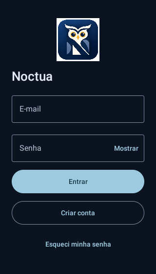
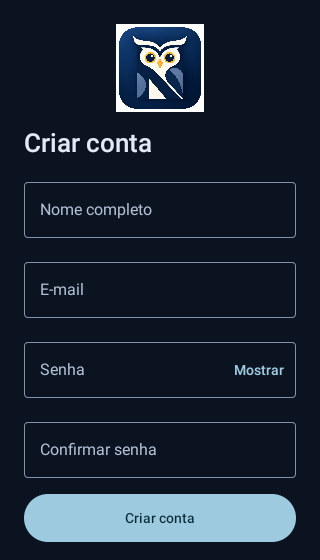
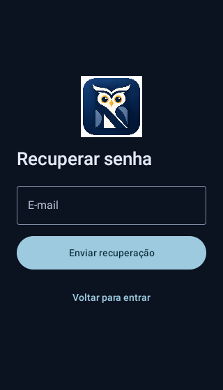
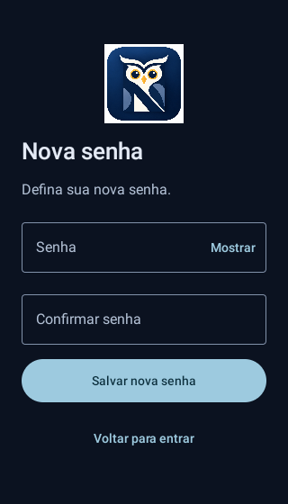
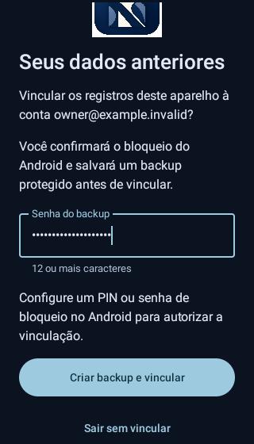
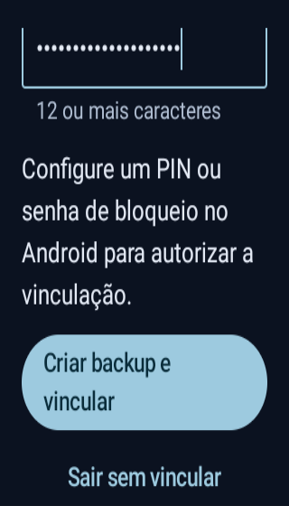
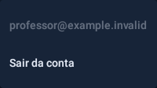

# Supabase Auth — homologação da candidata 0.20.0 / código 38

**CI e atualização assinada aprovados. Homologação física pendente.**
A branch `main` permanece na estável **0.19.1 / código 37**. Não houve promoção
para distribuição pública nem geração de outro APK nesta consolidação.

## Identificação e artefatos

| Item | Referência verificada |
| --- | --- |
| Branch | `auth/supabase-protected-workspaces` |
| Código do APK | [`c24a7d95d6e7230fce4daa518747cf95ff062e4d`](https://github.com/italocesarfr-sketch/CHATGPTCODEX/commit/c24a7d95d6e7230fce4daa518747cf95ff062e4d) |
| Versão | 0.20.0 / versionCode 38 |
| Identificador | `br.com.diariodeclasse` |
| Actions | [40812203803 — aprovado](https://github.com/italocesarfr-sketch/CHATGPTCODEX/actions/runs/40812203803) |
| Autenticação, isolamento e regressão | [Job 123244907495 — success](https://github.com/italocesarfr-sketch/CHATGPTCODEX/actions/runs/40812203803/job/123244907495) |
| Atualização assinada da 0.19.1 | [Job 123249653186 — success](https://github.com/italocesarfr-sketch/CHATGPTCODEX/actions/runs/40812203803/job/123249653186) |
| APK candidato assinado | [noctua-auth-homologacao — artefato 12871771954](https://github.com/italocesarfr-sketch/CHATGPTCODEX/actions/runs/40812203803/artifacts/12871771954) |
| Testes e capturas | [resultados-etapa6 — artefato 12870419947](https://github.com/italocesarfr-sketch/CHATGPTCODEX/actions/runs/40812203803/artifacts/12870419947) |
| Provas da atualização assinada | [resultados-atualizacao-release — artefato 12871099707](https://github.com/italocesarfr-sketch/CHATGPTCODEX/actions/runs/40812203803/artifacts/12871099707) |

A revisão de retomada consultou as execuções mais recentes do repositório: não
havia execução posterior a 40812203803. As falhas e o cancelamento anteriores
foram superados por essa execução aprovada; não representam o estado atual.

O APK foi baixado do artefato existente e conferido novamente, sem recompilar.
O `workflow_run.head_sha` dos artefatos corresponde ao commit acima. Seu SHA-256
coincide com `apk-tested.sha256`, `identidade-apk.json` e o checksum publicado:

```text
APK SHA-256:
31dd1dfdd740658137aa2de7529070a1c7bce4a7342e620e10874310fb77353a

Certificado SHA-256 (mesmo da 0.19.1 original):
6dbbba2d930eb7f7fbeff1ee82512f656251bbec9f4b31b6c5614528d29f1aae
```

Package, versionName e versionCode foram lidos do APK; a assinatura v2 foi
verificada com `apksigner`. O APK é release, sem `debuggable`. O scanner e a revisão
do código confirmaram ausência de entrada demonstrativa, clientes fictícios de
instrumentação e chaves administrativas no cliente. A configuração incorporada
contém somente a URL e a Publishable Key públicas autorizadas.

## Resultados consolidados

| Verificação | Resultado da execução aprovada |
| --- | --- |
| JVM comum | **205 casos: 204 aprovados, 1 condicional ignorado, zero falhas/erros** |
| Android comum | **328 casos: 322 aprovados, 6 condicionais ignorados, zero falhas/erros** |
| Cliente Kotlin no Supabase real | **1 aprovado**, em execução opt-in separada; zero ignorados |
| Foco autenticação, isolamento e entrada/saída | 18 aprovados; são repetições de casos da suíte Android, não somados ao total |
| Fonte Android 1,3 e 1,6, largura 320 dp | 2 casos aprovados em cada escala, incluindo vinculação sem PIN |
| Backup protegido | Leitor Python independente validou ASCII/Unicode, texto exato e rejeição de adulteração do titular |
| Exportadores anteriores | XLSX, CSV e TSV; chamada, anual e planos validados por leitores independentes |
| Room | Esquema v10 e migrações anteriores preservados; nenhum arquivo de esquema alterado |

As contagens foram extraídas dos XMLs publicados, não da mensagem de progresso
do Gradle. São **526 casos comuns aprovados**. O teste real de backend e as fases
das sondas abaixo são relatados separadamente, sem somar repetições como novos casos.

[Resumo dos XMLs](evidencias/auth-0200/ci-validation-result.json) ·
[Integração Kotlin real](evidencias/auth-0200/kotlin-live-result.json) ·
[Atualização assinada](evidencias/auth-0200/signed-upgrade-result.json).

### Testes condicionais

O teste JVM `SupabaseLiveAuthTest` é ignorado na suíte comum porque depende de
credencial autorizada em arquivo privado. Foi executado separadamente contra o
Supabase real e passou. O cliente `SupabaseAuthClient.kt` utilizado nessa prova
não foi alterado entre o commit da evidência e o commit do APK candidato.

Os seis casos Android condicionais exigem argumentos específicos e, por isso,
aparecem como ignorados na suíte comum:

| Sonda | Execução específica e resultado |
| --- | --- |
| `UpgradeProbeTest` | Antes/depois da atualização da fixture v1: **2 fases aprovadas**, oito tabelas e resgate conferidos |
| `FrequencyProcessProbeTest` | Escrita/leitura após encerramento do processo: **2 fases aprovadas** |
| `AuthProcessProbeTest` | Escrita e leitura após **reinício real do emulador**: **2 fases aprovadas**, sessão cifrada, seleção e FJ/motivo preservados |
| `StableUpgradeProbeTest` | **8 fases aprovadas** sobre o APK original 0.19.1: semente, atualização, backup/restauração, reabertura, exclusão de histórico e de aluno e respectivas reaberturas |
| `AuthSignedUpgradeProbeTest` | **1 fase aprovada**: legado bloqueado antes da vinculação, backup verificado, titularidade, outra conta isolada e retorno à conta original |
| `ReleaseContinuityProbeTest` | Ensaio histórico **não executado nesta rodada**; substituído neste workflow pela atualização real com o certificado permanente acima |

A atualização assinada totaliza **nove fases aprovadas**, sem desinstalação.
Os testes usam exclusivamente dados fictícios em emuladores descartáveis.

## Arquitetura e preservação acadêmica

`SupabaseAuthClient` usa a API GoTrue HTTPS (`/auth/v1`) do projeto `noctua-auth`.
Não há envio de turmas, estudantes, notas, frequências, diários ou horários ao
Supabase, nem sincronização acadêmica. Nenhuma dependência Android nova foi
introduzida. Kotlin, Jetpack Compose/Material 3, Repository e Room permanecem.

`AuthController` serializa operações e invalida respostas atrasadas após logout
ou novas credenciais. A identidade é verificada por GET `/user`; não se confia
apenas em um JWT decodificado ou no e-mail digitado. Não há logger HTTP, senha
persistida, chave `service_role`/`sb_secret_` ou credencial administrativa no APK.

`AuthRoot` só disponibiliza o espaço acadêmico após autenticação válida e as
proteções de titularidade. Os ViewModels são separados por conta e retidos durante
rotação. O logout esvazia seu store e fecha o espaço anterior; respostas antigas
não podem reabrir a conta. `DiaryApplication` não abre Room antes da admissão.
Clientes fictícios existem somente no APK separado de instrumentação, que não
integra o artefato entregue ao proprietário.

### Banco antigo e vinculação

**Não houve migração de esquema para a autenticação.** Room continua v10,
com todas as migrações anteriores. A sonda v1 validou a cadeia antiga; a atualização
assinada original 0.19.1 → candidata validou v10 → v10, preservando snapshots
acadêmicos, identidades e preferências. Não há migração destrutiva.

A conta proprietária é identificada pelo UUID imutável obtido no login real
confirmado da conta autorizada. Outra conta não pode assumir o legado.
A primeira vinculação exige cumulativamente:

1. Conta autorizada com e-mail confirmado e sessão ainda válida.
2. Consentimento explícito, identificando o e-mail verificado na tela.
3. Confirmação pelo bloqueio do próprio Android.
4. Destino escolhido e senha de backup com pelo menos 12 caracteres.
5. Backup completamente gravado, relido, decifrado e comparado aos bytes e ao
   snapshot original, antes de gravar atomicamente a titularidade.

O direito de acesso é revalidado antes de ler/exportar o legado e antes de gravar
a titularidade. Sessão expirada, ausência de PIN, cancelamento, troca de conta e
falha de arquivo impedem a vinculação. Não se copiam, renumeram nem reassociam
linhas de estudantes, matrículas, frequências ou históricos.

Para o proprietário, o arquivo continua `databases/diario.db`. Para outras contas,
usa-se `databases/accounts/<SHA-256 do UUID>/diario.db`. Seleção de ano/turma,
cópias de segurança, cache e ViewModels também são separados. A fila de gravações
anterior termina antes de fechar a base. O logout não apaga dados acadêmicos nem
a titularidade já confirmada.

Os testes verificaram notas zero e vínculos acadêmicos, recomposições, P/F/FJ/NR,
motivo de FJ, remanejamentos, diário, grade semanal, preferências e reabertura.
O acesso cruzado, a abertura prematura do legado e a restauração de backup
protegido de outra conta foram recusados. As identidades entre duas contas foram
injetadas na instrumentação; isso não é alegado como teste de dois usuários reais
no backend. **Os dados reais do aparelho ainda precisam da conferência física.**

O FileProvider revalida a conta em consulta e abertura de exportações temporárias.
URIs de outra conta ou após logout são recusados. Cópias já salvas/compartilhadas
fora do app, inclusive backups legados em texto e conteúdo da área de transferência
anterior à atualização, não podem ser protegidas retroativamente.

### Sessão e uso offline

Sessão, refresh token e estado PKCE são cifrados com Android Keystore AES-GCM,
AtomicFile e `noBackupFilesDir`. A titularidade possui arquivo cifrado separado e
sobrevive ao logout. Corrupção/perda da chave bloqueia acesso; não limpa nem recria
o banco. O Auto Backup Android continua desativado.

Após autenticação online confirmada, a mesma conta pode trabalhar offline por
**até sete dias desde a última verificação online**. O app revalida na entrada,
no retorno e periodicamente; renova tokens próximos da expiração ou após
15 minutos sem verificação. Falha temporária de rede/servidor não é tratada como
credencial inválida. Revogação percebida online encerra a admissão local.

O prazo esgotado e o recuo do relógio além da tolerância exigem conexão para
revalidar. A política depende do relógio do aparelho, não de relógio seguro de
hardware. Revogação remota não pode ser detectada imediatamente sem internet.
A persistência no Keystore e o acesso offline após reiniciar o emulador passaram;
a indisponibilidade do backend foi simulada nesse teste.

### Backups

O **BackupCodec acadêmico continua no formato 12**, lendo os formatos anteriores.
O arquivo externo novo é um contêiner binário versionado **1**, extensão `.noctua`:
AES-256-GCM, PBKDF2-HMAC-SHA256 com 600.000 iterações, sal aleatório de 16 bytes,
IV de 12 bytes e titularidade/cabeçalho autenticados como AAD. O payload mantém
os registros acadêmicos originais. Limites: 32 MiB de payload e 33 MiB de entrada.

A senha não é persistida nem enviada ao Supabase. É independente da senha da
conta e necessária para restaurar, inclusive em outro aparelho com a mesma conta.
**Senha de backup esquecida não pode ser recuperada.** Outra conta, senha errada
ou adulteração são rejeitadas antes da restauração. O leitor independente validou
o contêiner, incluindo senha Unicode e adulteração do titular.

Backups antigos continuam restauráveis pela conta proprietária, com confirmação
do bloqueio Android, prévia e confirmação `RESTAURAR`. A cópia de segurança anterior
à restauração continua privada da conta. A mensagem de sucesso só aparece depois
de gravar, concluir o flush e fechar o arquivo. Falha/cancelamento não indicam sucesso.

## Integração real com Supabase e retorno Android

| Percurso | Evidência efetiva |
| --- | --- |
| Cadastro da conta autorizada | Aceito pelo serviço; nenhuma conta do piloto criada |
| Login antes de confirmar o e-mail | Recusado com `email_not_confirmed` |
| Confirmação do e-mail | Proprietário abriu a mensagem; confirmação posteriormente verificada no servidor, apesar do retorno antigo a localhost |
| Login confirmado, identidade e refresh | Aprovados pelo cliente Kotlin real |
| Senha incorreta | Recusada pelo serviço |
| Logout e refresh revogado | Aprovados pelo cliente Kotlin real |
| Atualização autenticada de senha via API | Aceita pelo serviço; não equivale ao percurso de recuperação pelo app |
| Solicitação de recuperação PKCE | Aceita pelo serviço; proprietário confirmou o recebimento do e-mail |
| Link → Android → nova senha → entrar | **Pendente de homologação física** |

A evidência real utiliza uma única caixa autorizada. Os testes de UI, isolamento,
expiração, concorrência e falhas usam clientes injetados; seus resultados não
substituem as chamadas reais acima. Senhas temporárias, tokens e verificadores
não constam dos documentos ou artefatos. O arquivo privado usado pela sondagem
foi removido após os testes. Não exclua nem recrie a conta autorizada: seu UUID é
usado para proteger a vinculação do legado.

### Callback e PKCE

O callback base no código e no manifesto é exatamente:

```text
br.com.diariodeclasse://auth/callback
```

Cada solicitação acrescenta um `state` aleatório. O retorno esperado inclui
`?state=...&code=...`. Esses parâmetros não mudam o esquema, host ou caminho do
callback. O app exige o estado criado neste aparelho, parâmetros únicos, ausência
de fragmentos e prazo de até 30 minutos. O verificador PKCE S256 é cifrado localmente.
Links arbitrários, outros caminhos, tokens implícitos e estado desconhecido são
recusados. A sessão de recuperação só abre a troca de senha, nunca os dados escolares;
após salvar, é necessário entrar novamente. Se o processo morrer nessa etapa,
solicite outro link.

A inclusão do retorno no Supabase foi informada pelo proprietário. A configuração
administrativa da allowlist não foi inspecionada com a chave pública. Na homologação,
confirmar que ela permite o callback exato **preservando o `state` de query string**.
Não substituir o callback por localhost nem remover a validação PKCE para contornar
falhas. O percurso no aparelho é a prova ainda pendente dessa configuração.

### SMTP

SMTP personalizado ainda não operacional; Resend sem domínio de envio verificado,
conforme configuração informada. A entrega ao endereço autorizado foi confirmada,
mas **não comprova cadastro ou recuperação para qualquer destinatário externo**.
A confirmação de e-mail não foi desativada e nenhum ajuste externo foi realizado
para contornar limites. As cinco contas corporativas continuam fora desta etapa.

## Roteiro seguro para homologação física

1. **Antes de atualizar**, na 0.19.1, crie um backup completo e confirme que foi
   salvo fora do armazenamento privado do aplicativo. Guarde-o em local protegido.
2. Baixe o [ZIP do candidato assinado](https://github.com/italocesarfr-sketch/CHATGPTCODEX/actions/runs/40812203803/artifacts/12871771954),
   extraia `app-release.apk` e instale como **atualização**. Não use o artefato debug,
   não desinstale e não limpe os dados. Se o Android exigir desinstalação, interrompa
   a instalação e informe somente a mensagem apresentada.
3. Abra **Esqueci minha senha**, informe o e-mail já autorizado e solicite um
   **link novo pelo próprio APK instalado**. Não crie outra conta para substituir
   a existente. Os links das sondagens anteriores não têm o verificador local do app.
4. Abra a mensagem **no mesmo aparelho** e toque no link dentro de 30 minutos.
   Deve abrir **Nova senha** no Noctua. Defina uma senha pessoal de oito ou mais
   caracteres, confirme e entre novamente. Se abrir localhost, outro navegador
   sem retorno, ou uma mensagem de link inválido, registre somente a etapa/mensagem
   e interrompa o percurso; não afrouxe as proteções.
5. Na tela **Seus dados anteriores**, confira a conta, escolha uma senha de backup
   com 12 ou mais caracteres e toque **Criar backup e vincular**. Confirme o PIN/senha
   no diálogo do Android e salve o backup protegido. Sem bloqueio Android, configure-o
   antes de continuar. Guarde o arquivo e sua senha separadamente do app.
6. Após a vinculação, confira turmas/anos, matrículas, notas e recomposições,
   P/F/FJ/NR e motivos, remanejamentos, diário, horários e preferências de planilha.
   Use conferências de leitura; não exclua registros nem restaure um backup sobre
   dados reais apenas para testar.
7. Feche/reabra; confira a seleção de turma/ano. Teste **Sair da conta**, reentre
   na mesma conta e confira os dados. Após autenticação válida, desligue a internet
   temporariamente, reabra e confira o acesso offline; depois reconecte.

Informe apenas quais etapas passaram ou onde parou. **Não envie senhas, PIN,
códigos, tokens, links, backups ou dados reais de estudantes.**

## Pendências antes da liberação estável

- Percurso completo de recuperação no APK instalado, incluindo abertura do link.
- Confirmação positiva do bloqueio Android e do salvamento pelo provedor de arquivos
  no aparelho do proprietário. O bloqueio sem PIN, o backup verificado e as proteções
  de titularidade já passaram no emulador.
- Conferência dos dados reais após atualização/vinculação, reabertura e offline.
- SMTP/domínio e entrega a destinatários externos para futura distribuição geral.
- TalkBack e demais fabricantes/versões Android: testes automatizados em API 30;
  verificação em outros aparelhos permanece manual.

Não há falha conhecida pendente na suíte obrigatória do commit validado. Essas
pendências reais impedem tratar o candidato como release pública homologada.
**Não promover automaticamente para `main`.** Nenhuma função pedagógica, conta
corporativa, NOcTuA Escola ou sincronização acadêmica foi acrescentada nesta retomada.

## Arquivos, revisão e capturas

[Lista dos arquivos alterados](evidencias/auth-0200/arquivos-alterados.txt).
Os módulos principais são `auth/`, inicialização/navegação e integração de backup,
cache/compartilhamento e ViewModels por conta. Entidades, cálculos, relatórios,
exportadores e migrações acadêmicas não foram reformulados.

A consolidação altera somente documentação e evidências. O APK permanece o mesmo
artefato testado do commit c24a7d9. Não houve novo build, versão ou teste longo.

Problemas anteriores resolvidos: fábrica Android dos ViewModels isolados; runner
compatível com o APK antigo; espera da fixture dirigindo o Compose; e seleção da
raiz correta ao capturar o popup de conta. As asserções de integridade foram
preservadas e o CI posterior passou. Esses incidentes não são falhas atuais.

Impeccable 4.7 foi consultada na implementação, em `.agents/skills/impeccable`,
para contexto Android, robustez, campos, toque, rolagem, erros e preservação da marca.
Não houve nova intervenção visual nesta consolidação.

Capturas sem edição, em 320 dp e com dados fictícios. Mostram a área visível após
rolagem quando necessária; o texto não foi reduzido para caber.

| Entrada | Cadastro | Recuperação |
| --- | --- | --- |
|  |  |  |

| Nova senha | Vinculação | Fonte 1,6 |
| --- | --- | --- |
|  |  |  |


