# Capturas — Etapa 6

Capturas reais de testes em emulador API 30, com dados exclusivamente fictícios. Antes: APK 0.10.0, Actions 39137573909. Depois: 0.11.0, [Actions aprovado](https://github.com/italocesarfr-sketch/CHATGPTCODEX/actions/runs/39146616428). As quatro páginas usam as mesmas fixtures de regressão. Os estados adicionais abaixo demonstram o diário e o cenário compacto; não são imagens de um aparelho físico.

| Página | Antes · 0.10.0 | Depois · 0.11.0 |
| --- | --- | --- |
| Turmas | 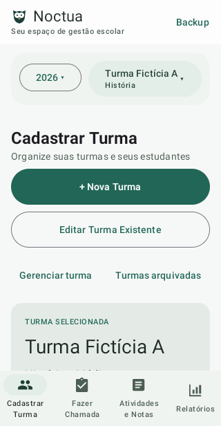 | 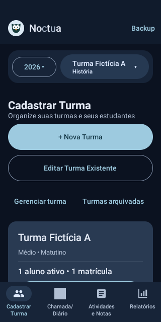 |
| Chamada / Diário | 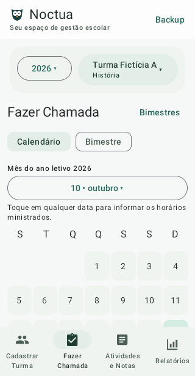 | 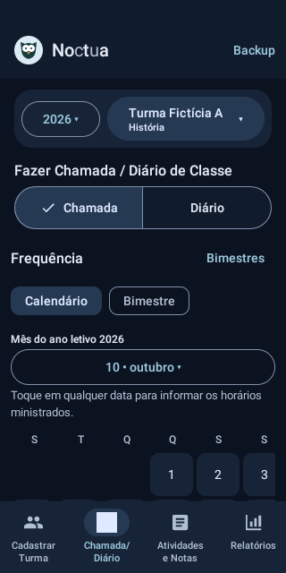 |
| Atividades e notas | 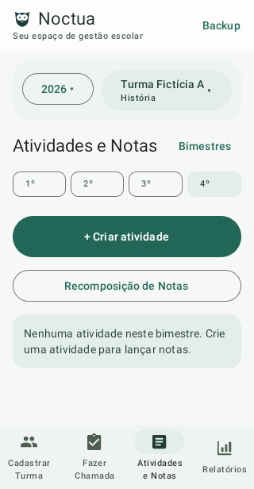 | 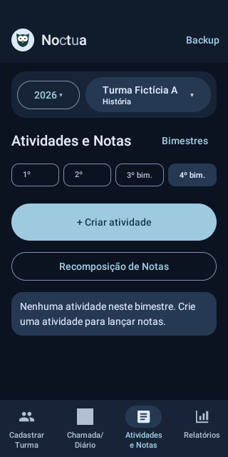 |
| Relatórios | 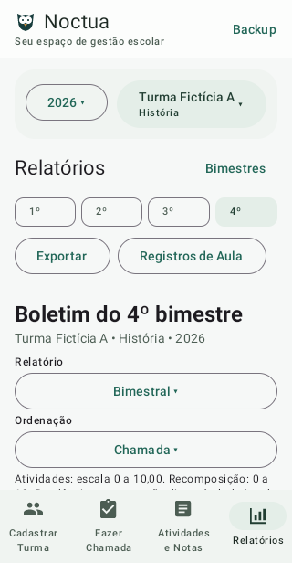 | 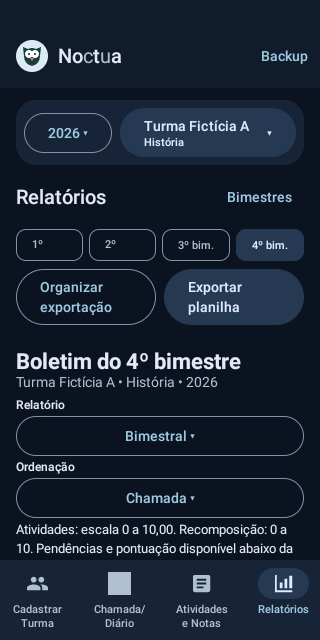 |

## Fluxos e acessibilidade

### 01 chamada bimestre

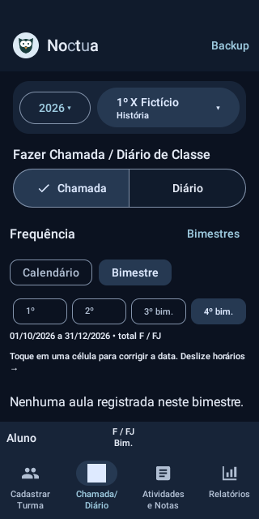

### 02 diario calendario

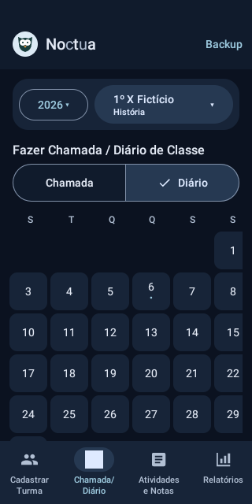

### 03 organizar exportacao

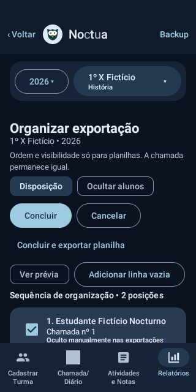

### 04 exportacao

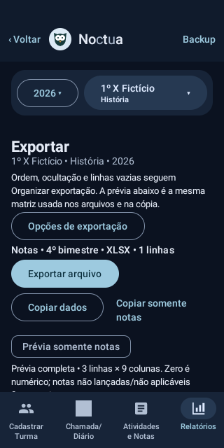

### 05 celular 320 fonte ampliada

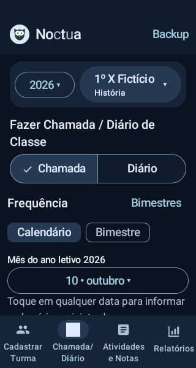

### 06 diario compacto

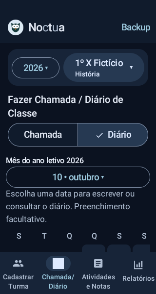

