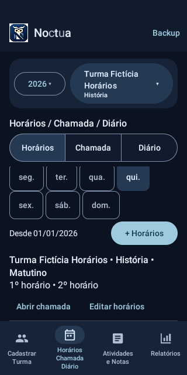
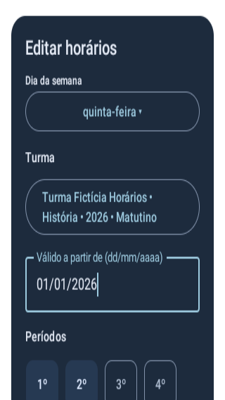
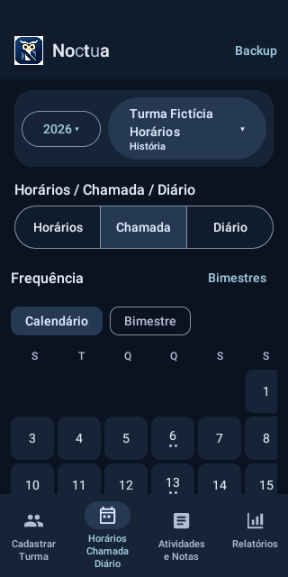
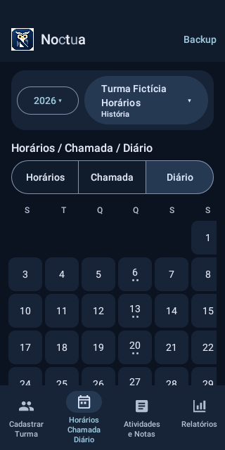
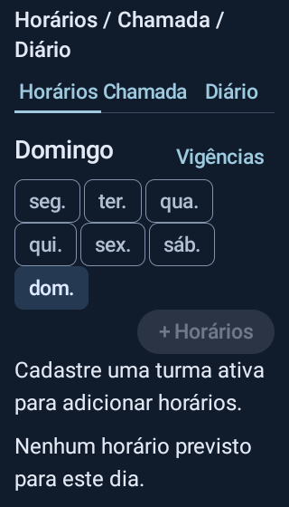
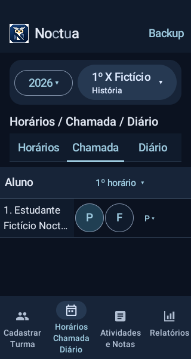

# NOcTuA Professor 0.17.0 — Horários, Chamada e Diário

Base: 0.16.0 / código 28. Incremento: 0.17.0 / código 29. Escopo exclusivamente local, sem sincronização ou novos cálculos acadêmicos.

## Uso

A segunda área reúne **Horários / Chamada / Diário**. No rodapé, os três nomes ocupam linhas separadas para permanecerem legíveis em celulares compactos. A Chamada continua sendo o modo inicial para preservar os caminhos anteriores. Com fonte ampliada, abas Material preservam os três nomes em uma linha; em larguras extremas, os controles se distribuem sem quebrar palavras. As áreas de toque mantêm no mínimo 48 dp. Na chamada em largura reduzida ou fonte ampliada, a data fica em linha própria, sem ser comprimida entre Calendário e Bimestre. Com fonte ampliada e horários já registrados, os controles do dia podem rolar para liberar espaço para a tabela; os alvos P/F mantêm 48 dp visíveis.

Em **Horários**, consulte segunda a domingo; o dia atual é selecionado inicialmente. A grade independe da seleção de turma. **+ Horários** permite escolher uma turma ativa do ano, dia, períodos de 1º a 12º e vigência. A quantidade deriva dos períodos escolhidos. O mesmo período não pode ser ocupado por duas turmas no mesmo dia e turno. O turno é reaproveitado do cadastro da turma, permitindo, por exemplo, 1º horário matutino e 1º horário noturno sem conflito. A lista ordena turnos e períodos.

O botão **Abrir chamada** seleciona a turma sem criar aulas. Para mudar a rotina, edite os períodos e informe a nova vigência. A revisão mostra o intervalo atingido e datas que já possuem chamadas ou conteúdos. Retirar horários da grade cria outra revisão, sem apagar aulas. **Vigências** permite consultar outras datas e as revisões anteriores, inclusive suas turmas e períodos.

Os dois calendários usam a mesma grade: pontos menores indicam uma ou duas aulas previstas; quantidades maiores aparecem numericamente. Leitores de tela recebem a quantidade em texto. Os indicadores atuais de frequência, cancelamento e diário continuam independentes.

Na chamada de uma data sem horários, a quantidade prevista vem selecionada; apenas **Registrar horários** grava aulas. Aulas existentes, inclusive canceladas, nunca são substituídas pela sugestão. As posições da grade pertencem à rotina do professor; os horários já utilizados pela chamada permanecem sequenciais por turma/data e não são renumerados pela grade. É possível registrar aulas excepcionais fora da grade. Um único conteúdo do Diário pode corresponder a várias aulas e o preenchimento continua facultativo.

## Persistência e vigência

Room **v9** acrescenta somente `weekly_timetables`. As quatorze tabelas v8 permanecem intactas. `MIGRATION_8_9` cria a tabela e o índice único `(year, effective, revision)`. Não há migração destrutiva, geração de aulas ou alteração de registros existentes.

Cada linha é um retrato imutável da semana inteira: UUID, ano, início de vigência, número da revisão, instante de criação e períodos serializados. Cada período tem UUID, dia ISO 1–7, posição, ID da turma e identificação descritiva congelada. Para uma data, prevalece a maior revisão da última vigência daquele ano. O fim é implícito: véspera da próxima vigência ou 31/12. Não há intervalos sobrepostos; revisões de uma mesma data são auditáveis e apenas a última é vigente.

Uma alteração futura parte da rotina vigente na data indicada e não modifica versões posteriores já cadastradas. A prévia explicita seu intervalo. Corrigir a mesma vigência acrescenta uma revisão; não apaga a anterior. O campo legado `classes.schedule` continua preservado, sem conversão automática: suas quantidades não identificam posições concretas e convertê-las poderia inventar conflitos.

O retrato da turma no período permite consultar revisões mesmo depois de sua exclusão. Não é um vínculo acadêmico órfão: é uma referência histórica autocontida, sem FK que bloqueie a exclusão ou apague revisões por cascata. Turmas arquivadas mantêm seus períodos com indicação histórica; não podem ganhar novos períodos até serem reativadas. Para deixar de reservar períodos de uma turma arquivada/excluída, retire-os explicitamente em nova vigência.

A confirmação revalida todas as revisões do ano, conflitos, turmas ativas para períodos novos, intervalo e datas com registros. Alteração concorrente exige nova conferência. A gravação acontece em transação Room. Falhas não deixam revisão parcial. Nenhuma operação de grade escreve em `lessons`, `marks`, atividades, notas ou diários.

## Backup e atualização

Backup **formato 11**, incluindo todas as revisões e períodos. Leitura dos formatos **1–10** mantida com grade inicialmente vazia. Backup 11 incompleto, adulterado ou conflitante é rejeitado antes da restauração. Restauração conserva a cópia privada de segurança, validação, transação e rollback existentes.

Pacote `br.com.diariodeclasse`, banco `diario.db`, funcionamento offline e workflows de assinatura permanente preservados. Referência pública do teste de atualização: `docs/baseline/noctua-release-0.16.0.json`. A configuração permanente de assinatura e os Secrets existentes permanecem preservados.

## Interface e limitações

Impeccable 4.7.0 consultado no diretório local `.agents/skills/impeccable`, com contexto, diretrizes nativas Android e craft floor. Aplicação: componentes Material 3, identidade atual, alvos de 48 dp, revisão antes de alterar vigências, estados vazios curtos e fontes ampliadas. Nenhuma tecnologia web foi introduzida.

Não há base institucional de feriados/recessos no esquema existente. A atualização não inventa essas datas e não cria qualquer registro automaticamente. Horários cancelados continuam identificados como cancelados, mesmo quando a rotina prevê aula. Horários de início/término não foram acrescentados: os períodos concretos bastam para esta versão.

## Validação

A validação principal do [Actions](https://github.com/italocesarfr-sketch/CHATGPTCODEX/actions/runs/39967631678), commit `0b52be6f3e574316c6d60653e7955f9fb6e7e170`, foi aprovada. Todos os cenários usam dados fictícios.

| Verificação | Resultado executado |
|---|---|
| JVM | 156 aprovados, zero falhas |
| Android completo | 260 casos: 256 aprovados, quatro sondas condicionais, zero falhas |
| Horários, Room, backup e interface | 13 aprovados |
| Layout e chamada compacta, incluindo P visível e salvo | 3 aprovados |
| Regressão dirigida anterior | 35 aprovados |
| Relatórios/exportação dirigida | 22 aprovados |
| Leitores independentes | 41 XLSX gerais + 2 de planos; 41 CSV e 123 TSV |

Os grupos dirigidos também integram a regressão completa; não são somados novamente ao total. As quatro sondas condicionais são `FrequencyProcessProbeTest`, `UpgradeProbeTest`, `StableUpgradeProbeTest` e `ReleaseContinuityProbeTest`. As duas primeiras são executadas nas fases próprias do CI; a atualização permanente usa a sonda estável nas fases próprias. A sonda antiga `ReleaseContinuityProbeTest` permanece opt-in, coberta funcionalmente pela sonda estável atual. Nenhum teste foi desabilitado para contornar falhas.

A migração 8→9 foi testada com comparação das quatorze tabelas anteriores e validação Room, sem alterar suas linhas. Os testes também exercitam conflitos por turno, revisão futura/histórica, exceções, P/F/FJ/NR e aulas canceladas, restauração/reinício, arquivamento, exclusão sem perder a grade histórica, concorrência e rollback. A sugestão e a navegação não gravam aulas ou conteúdos.

A instrumentação usou emulador API 30, largura de 320 dp e fontes 1.0/1.3/1.6 nos modos. O fluxo completo de chamada foi exercitado em 320 × 600 dp com fonte 1.3: registrar horário, expor a tabela, verificar o P inteiro de 48 × 48 dp, tocar e conferir a presença persistida. A geometria real está em [08-geometria.txt](images/horarios-0170/08-geometria.txt).

As falhas iniciais foram corrigidas sem remover as verificações: retorno de teste JUnit, rolagem até item fora da área visível, expectativa da migração antiga após abertura v9 e acesso às células em rolagens aninhadas. A revisão das capturas identificou nomes quebrados e data comprimida; os controles se adaptam ao tamanho da fonte e a tabela ganha espaço por rolagem.

## Release e atualização assinada aprovadas

A execução completa terminou com **success** nos dois jobs. [Baixar release assinado](https://github.com/italocesarfr-sketch/CHATGPTCODEX/actions/runs/39967631678/artifacts/12509400181): o ZIP contém `app-release.apk`, de **8.618.728 bytes**, versão **0.17.0 / 29**. A assinatura v2 foi verificada no CI e novamente no arquivo baixado.

O pacote continua `br.com.diariodeclasse`. O certificado SHA-256 permanece `6dbbba2d930eb7f7fbeff1ee82512f656251bbec9f4b31b6c5614528d29f1aae`, igual ao APK original **0.16.0 / 28**, obtido da execução `39864960677`. SHA-256 do APK novo: `25199cab7d74519c607c41087b759a982f9ca8c166fc0c0d2c5cba273cd0fbe4`.

O teste instalou a referência original, criou dados fictícios e instalou o candidato com **`adb install -r`**, sem desinstalar. As seis fases `before`, `after`, `backup`, `reopened`, `deleted-history` e `reopened-history` retornaram **OK (1 test)**. Foram comparados registros, IDs, preferências, notas, chamadas, recomposições, auditorias, diários e históricos de remanejamento. A nova grade também foi criada após a atualização, incluída no backup, restaurada e conferida após reinício. O teste de exclusão de origem/intermediária continuou preservando resultados e históricos.

Os comprovantes estão no [artefato de atualização assinada](https://github.com/italocesarfr-sketch/CHATGPTCODEX/actions/runs/39967631678/artifacts/12508856136). A confirmação final combina identidade criptográfica, instalação real de atualização e comparação de dados; não se baseia apenas no número da versão.

O APK foi baixado e conferido localmente com `apksigner`, `aapt`, `apk_identity.py` e `check-apk-update.py`; seus hashes coincidem com os publicados pelo CI. Nenhum teste foi executado em aparelho pessoal, nenhum dado real foi utilizado, e a chave e o certificado permanentes e os Secrets existentes foram preservados. **O teste físico pelo proprietário permanece pendente**, assim como a conferência subjetiva de uso em outros aparelhos. Antes de instalar no aparelho de trabalho, preserve um backup pelo próprio aplicativo. Não é necessário desinstalar a 0.16.0 oficial assinada com esse mesmo certificado.

Código testado: [`0b52be6f3e574316c6d60653e7955f9fb6e7e170`](https://github.com/italocesarfr-sketch/CHATGPTCODEX/commit/0b52be6f3e574316c6d60653e7955f9fb6e7e170). A publicação posterior de resultados, README e capturas é somente documental; não muda o código do APK validado.

## Capturas reais

| Grade semanal | Cadastro de períodos |
|---|---|
|  |  |

| Chamada: previsão | Diário: mesma previsão |
|---|---|
|  |  |

| Fonte 1.6, sem turma selecionada | Chamada compacta com presença salva |
|---|---|
|  |  |

As imagens vêm da instrumentação nativa no emulador, sem redesenho ou recorte da interface. O editor tem rolagem; a imagem mostra os campos e períodos, enquanto os testes também acessaram Revisar/Confirmar.

## Arquivos

Modelo e persistência: `WeeklyTimetable.kt`, `Database.kt`, `DiaryMigrations.kt`, `DiaryRepository.kt`, `ClassLifecycle.kt`, `BackupDao.kt`, `BackupCodec.kt` e `BackupManager.kt`. Interface: `TimetableScreen.kt`, `DiaryApp.kt`, `ClassJournalArea.kt`, `CalendarScreen.kt`, `SchoolCalendar.kt` e `DayAttendanceScreen.kt`. Esquema novo: `app/schemas/br.com.diariodeclasse.data.DiaryDatabase/9.json`.

Testes novos: `TimetablesTest.kt`, `TimetableInstrumentedTest.kt`, `TimetableUiInstrumentedTest.kt` e `TimetableLayoutInstrumentedTest.kt`. Testes anteriores mantidos e adaptados somente para a versão do esquema/formato ou apresentação; a chamada compacta passou a conferir também a data inteira e uma presença real. Versão, workflow Android, referência pública 0.16.0 e `scripts/ci/validate-android.sh` foram atualizados. A lista completa, hashes e contagens estão em [HORARIOS_0170_RESULTADOS.json](HORARIOS_0170_RESULTADOS.json).
