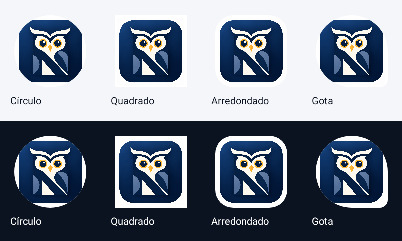
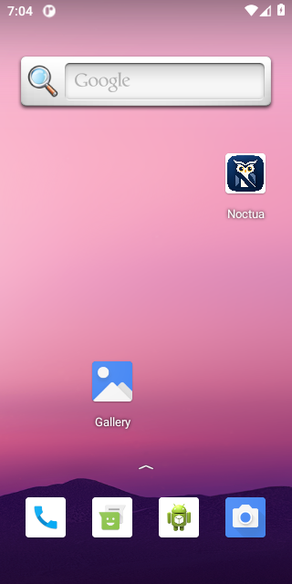
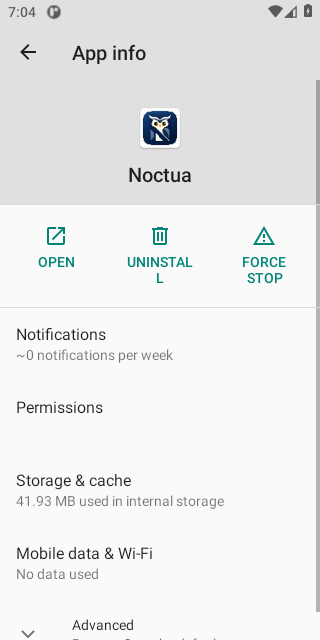
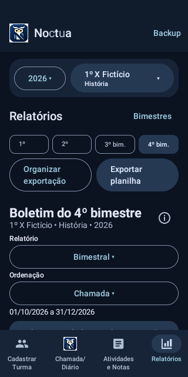

# Marca oficial Noctua

Base: Noctua 0.11.2 (18), commit `1c018f7`. Incremento restrito à marca: **0.11.3 / código 19**. Funcionalidades, tema, navegação, banco e assinatura não são reformulados.

## Arte do proprietário

O proprietário aprovou como identidade oficial a coruja geométrica formada pela estrutura da letra **N**. O RAR enviado contém somente `Ícone de Coruja N Geométrica.png`, RGB, 1254 × 1254 pixels. Nenhum documento do anexo foi tratado como instrução.

- Original preservado em [brand/noctua-original.png](brand/noctua-original.png).
- O recurso `app/src/main/res/drawable-nodpi/noctua_logo.png` é **idêntico byte a byte ao PNG recebido**, sem recorte, redesenho, recoloração, vetorização, nova compressão ou geração de imagem por IA.
- SHA-256 original: `ef7129c4a637fed0361645f3356c2597de2703cd524178ff7a9ba44b0ff84baa`.
- Metadados e checksum dos pixels RGB em [brand/noctua-oficial.json](brand/noctua-oficial.json).

O redimensionamento é feito nativamente pelo Android ao desenhar a imagem, preservando sua proporção. Não foi necessário gerar cópias por densidade: recursos `anydpi`/`nodpi` permitem reutilizar a mesma arte sem perdas intermediárias. O PNG original permanece no projeto como fonte de referência. A proposta vetorial anterior é apenas um registro histórico, sem aplicação no app.

## Recursos Android

| Recurso | Uso |
| --- | --- |
| `drawable-nodpi/noctua_logo.png` | Arte oficial integral, cabeçalho e ícone da área Chamada/Diário |
| `mipmap-anydpi/ic_launcher.xml`, `ic_launcher_round.xml` | Fallback padrão usando a própria imagem |
| `mipmap-anydpi-v26/ic_launcher.xml`, `ic_launcher_round.xml` | Ícones adaptativos, padrão e redondo, Android 8.0+ |
| `drawable/noctua_launcher_foreground.xml` | Imagem proporcional com margens de segurança, sem modificar os pixels do arquivo |
| `values/noctua_brand.xml` | Fundo branco do ícone, correspondente à moldura branca já existente na arte |

O manifesto usa `@mipmap/ic_launcher` e `@mipmap/ic_launcher_round`. A imagem ocupa 66 dp da camada de 108 dp, com margem de 19,444444% por lado. A coruja/N cabe no círculo seguro central; a máscara escolhida pelo launcher pode recortar somente o enquadramento externo. Não se promete controlar a máscara ou sombras aplicadas por cada fabricante. Não foi criada variante monocromática, pois ela substituiria as cores oficiais.

No cabeçalho compartilhado das quatro páginas e telas secundárias, `Image`/`ContentScale.Fit` exibe a arte em 32 dp, no mesmo espaço do emblema anterior, sem tingimento pelo tema. O ícone da área Chamada/Diário usa a mesma arte em 23 dp, sem filtro de cor. Nome, tipografia, textos, demais ícones e paleta noturna permanecem iguais. Os dois vetores provisórios `drawable/ic_owl.xml` e `drawable/ic_diary.xml` foram removidos após substituir todas as referências.

## Validação

`scripts/validate-noctua-brand.py` confere os arquivos originais, checksums, configuração do manifesto, recursos padrão/adaptativos/redondos e geometria da zona segura, sem editar imagens.

Os testes Android conferem os **pixels RGB do recurso realmente empacotado**, resolução/proporção, ícone carregado pelo PackageManager/LauncherApps e ausência de corte em pontos extremos da coruja/N. Renderizam máscaras em fundos claro/escuro. Um fluxo exclusivo de emulador abre o launcher, posiciona o ícone na tela inicial e abre as configurações do aplicativo, coletando capturas reais. Outro teste consulta as quatro páginas, confere a marca sem distorção/tingimento, verifica azul e dourado e compara o backup antes/depois. A regressão anterior permanece no CI.

O workflow reutiliza a chave permanente existente e testa a atualização real **0.11.2 → 0.11.3**, sem desinstalar. Room **v7**, backup **8**, pacote `br.com.diariodeclasse` e banco `diario.db` permanecem inalterados. Não foi criada nem alterada chave, senha ou Secret.

## Capturas conferidas

Capturas reais dos testes em emulador API 30, com dados exclusivamente fictícios. Nenhum mockup ou imagem recriada por IA. A simulação de máscaras desenha as próprias camadas Android da arte instalada.

| Tela inicial do Android | Configurações do aplicativo | Cabeçalho do Noctua |
| --- | --- | --- |
|  |  |  |

[Ícone na lista de aplicativos do launcher](brand/capturas/02-launcher-lista-apps.png).

## Resultado da entrega

**Noctua 0.11.3 / código 19 concluída.** [Actions aprovado](https://github.com/italocesarfr-sketch/CHATGPTCODEX/actions/runs/39156642035), código [`c91d9a9`](https://github.com/italocesarfr-sketch/CHATGPTCODEX/commit/c91d9a90b638f44f4f84205c58f3184b72b72932).

- `testDebugUnitTest`, `assembleDebug`, `assembleDebugAndroidTest` e `assembleRelease` aprovados.
- **102 JVM e 171 Android aprovados**, zero falhas. Incluem três testes novos de marca: PNG empacotado e geometria, launcher/tela inicial/configurações e logo interna nas quatro páginas.
- Quatro sondas condicionais ignoradas na suíte comum. As sondas legadas, de frequência entre processos e de atualização assinada foram executadas separadamente (duas + duas + seis fases aprovadas). O ensaio histórico ReleaseContinuity continua substituído pelo teste da release real com a assinatura permanente.
- Cinco capturas reais revisadas: máscaras claras/escuras, lista de apps, tela inicial, configurações e cabeçalho. O símbolo e as cores originais foram preservados; não foram identificados cortes na coruja/N nos cenários testados.
- Atualização **0.11.2 (18) → 0.11.3 (19)** com a mesma assinatura, sem desinstalar, preservação de registros fictícios, backup/restauração e reinício aprovados. Também passou a regressão de exclusão de origens/intermediárias com histórico preservado.
- Esquemas Room, classes de persistência/backup/regras/relatórios/exportação, tema e workflow release manual conferidos contra a base, sem alterações.
- APK release baixado e verificado por `apksigner`: assinatura APK v2 válida, pacote `br.com.diariodeclasse`, versão 0.11.3/19, mínimo API 26 e sem permissão INTERNET. Os pixels RGB do PNG dentro do **APK release** também são idênticos aos da arte original, mesmo com a otimização dos nomes dos recursos feita pelo Android Gradle Plugin.

[Baixar APK release assinado — ZIP](https://github.com/italocesarfr-sketch/CHATGPTCODEX/actions/runs/39156642035/artifacts/12147836423). Extrair `app-release.apk`. O nome histórico do artefato continua `noctua-etapa6-release`; a versão interna foi conferida. [Resultados dos testes e capturas](https://github.com/italocesarfr-sketch/CHATGPTCODEX/actions/runs/39156642035/artifacts/12147655491) · [Provas da atualização assinada](https://github.com/italocesarfr-sketch/CHATGPTCODEX/actions/runs/39156642035/artifacts/12147716768) · [Metadados](LOGO_OFICIAL_RESULTADOS.json).

APK existente em `app/build/outputs/apk/release/app-release.apk`, 8.452.686 bytes. SHA-256: `7081e85866391959d9623810636ef21be1ba66fbdd951e730a24f5c0f6f31271`. Certificado público SHA-256: `6dbbba2d930eb7f7fbeff1ee82512f656251bbec9f4b31b6c5614528d29f1aae`, igual ao da referência. Hashes dos ZIPs conferidos. Nenhuma chave, senha ou Secret foi criado/substituído.

O primeiro push de código foi substituído por um ajuste no teste para aceitar a preferência legítima do Android pelo recurso padrão **ou** redondo. A execução final teve zero falhas; o comportamento do app não precisou de correção posterior.

**Limites:** validação em emulador API 30, incluindo o launcher real e configurações do Android, sem novo teste em aparelho físico ou em todos os fabricantes/versões. As quatro máscaras são renderizações nativas das camadas instaladas. O estilo de máscara/sombra é controlado pelo launcher; ícones temáticos monocromáticos não fazem parte desta entrega. Faça backup antes de atualizar e utilize a release com assinatura compatível, sem desinstalar. O artefato de APK expira após 30 dias: guarde o arquivo.
