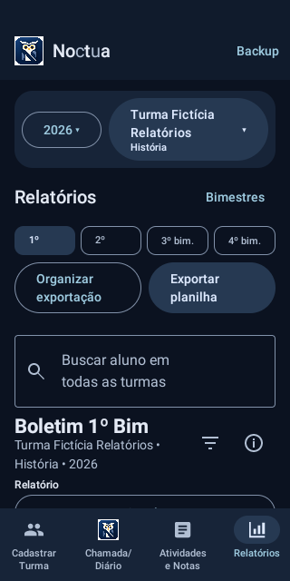
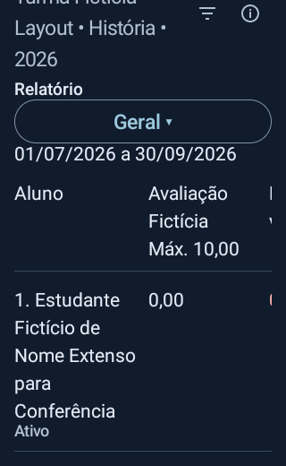
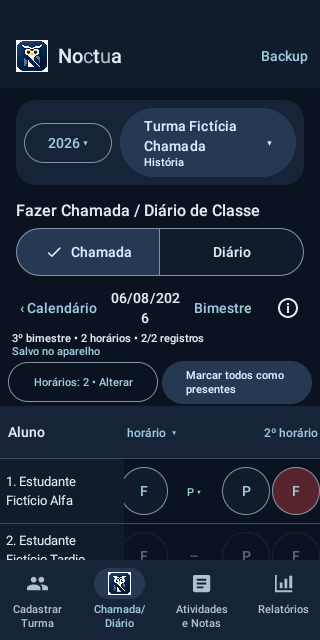

# Noctua 0.13.0 / 23 — relatórios e correções de horários

Base: 0.12.1 / 22, commit `66bd711`. Escopo restrito aos refinamentos autorizados. Pacote `br.com.diariodeclasse`, banco `diario.db`, Room v7 (14 tabelas), backup formato 8, migrações e assinatura permanente preservados. Nenhuma dependência nova.

## Relatórios e exportação anual

Busca global mantém a mesma pesquisa e recebe lupa no início. Títulos do boletim usam “Boletim 1º Bim” a “Boletim 4º Bim”. Retirado Consultas; o histórico anual individual e as projeções anteriores continuam disponíveis.

O ícone de ordenação abre Chamada, Mais faltas, Menos faltas, Maior nota e Menor nota. Selecionar novamente a opção ativa retorna à Chamada. O menu fecha após a escolha; um ponto e a cor do ícone identificam a ordenação ativa, também anunciada no rótulo acessível. Desempate reaproveita número, nome e ID da chamada. Durante a busca global os filtros permanecem ocultos. Geral, Frequência e Notas preservados.

“Exportar relatório anual”, em Exportar planilha, reutiliza `ExportProjection` no modelo Frequência e `SchoolReports.year`. Inclui chamada, nome, turma/ano, matrícula, indicadores de cada bimestre e consolidação anual: aulas elegíveis, registros válidos, P, F, FJ, faltas efetivas, NR e percentual. O percentual anual é o já calculado pelo aplicativo, não a média dos percentuais. Não há média anual de notas nem nova fórmula acadêmica.

A opção anual usa ordem oficial; respeita ocultação manual e exclusão automática de remanejados na origem. Linhas vazias e ordem personalizada continuam nas exportações existentes, mas não nesta relação anual em ordem de chamada. Históricos consolidados no destino continuam nas projeções existentes, inclusive após exclusão de origens/intermediárias. Valores são células numéricas, percentuais sem dados ficam vazios. Mesmo escritor OOXML, prévia, seletor Android, gravação e compartilhamento da chamada; nenhuma gravação escolar ao exportar. Fluxo também disponível para turmas arquivadas.

## Reativação transacional

`setDayHours` exige confirmação separada para reativar os horários cancelados cujo ordinal é menor ou igual à quantidade solicitada. A confirmação precede qualquer escrita, inclusive quando há também cancelamentos excedentes. Ao confirmar, reutiliza os IDs e todas as marcações/observações; cria somente os ordinais faltantes. Cancelados excedentes continuam cancelados. Reativação não preenche presenças em chamadas antigas vazias. A preferência existente de presença inicial continua aplicada aos demais horários como anteriormente.

A interface pergunta “Reativar N horários cancelados?” e permite Não/Reativar. Cancelar não altera nada. Redução mantém confirmação; reativação individual permanece disponível. Operação única `Room.withTransaction`; erro intermediário reverte todas as alterações.

## Limpar horários do dia

Ação discreta em Chamada → Alterar horários, preservando o espaço útil da tabela. Confirmações substituem temporariamente o formulário, sem empilhar janelas. Conferência somente leitura e confirmação “Remover os horários desta data?”. A confirmação captura turma, data e lista de horários, não a seleção global futura. O Repository repete todas as verificações dentro da transação e recusa se os horários tiverem mudado.

Por segurança, **qualquer** marca persistida (inclusive NR explícito após desmarcar), observação não vazia, registro do diário, atividade ou recomposição naquela turma/data bloqueia a limpeza. Referências no histórico preservado também bloqueiam. Não exclui alguns horários enquanto outros do mesmo dia têm registros. O aviso curto informa que os horários foram preservados; cancelamento e reativação continuam disponíveis. A conferência é somente leitura e mostra recusas no próprio formulário, fora da fila de gravação de chamadas: uma recusa não gera pendências falsas de salvamento.

Somente quando o dia está realmente vazio remove as linhas `lessons` daquela turma/data/IDs. A consulta também exige ausência de marca e observação; quantidade inesperada de remoções ou erro produz rollback completo. Não usa cascatas nem apaga marcas, diários, notas ou histórico. Datas distintas e outras turmas permanecem intactas. Calendário existente diferencia NR, cancelado e ausência de horários; após remoção não há indicador.

## Validação

- Compilação local `testDebugUnitTest assembleDebug assembleDebugAndroidTest`: aprovada; 112 testes JVM sem falhas na primeira validação completa.
- Planilha anual lida pelo openpyxl, conferindo conteúdo, células numéricas/vazias, dimensões e integridade ZIP. Regressão das demais matrizes mantida no CI.
- Novos testes Room: ciclo 2→0→1→2, IDs e marcações após reinício, combinação com horários novos, cancelamento sem confirmação, limpeza dirigida, proteção de NR/P/F/FJ/observação/diário/atividade/recomposição, confirmação desatualizada, rollback de remoção e reativação, backup/restauração e FK.
- Testes de interface atualizados aos rótulos/controles solicitados sem retirar verificações de integridade; novos fluxos de reativação, cancelamento, limpeza/calendário e exportação anual.
- CI e atualização assinada: **aprovados** no commit `a001de35896e7819040ee56a90df0bef52bc16f7`. Referência fixada no APK release real 0.12.1 do run 39357929630; hash e certificado conferidos antes de instalar por cima no emulador descartável. Workflow manual de release e Secrets não alterados.

Limitações: testes usam dados fictícios em emulador. Não representam validação em todos os fabricantes, provedores de documentos ou Microsoft Excel em aparelho físico. Não executar limpeza ou testes destrutivos em aparelhos com registros reais. A compatibilidade de instalação depende da igualdade do certificado com o APK de referência, verificada pelo processo de release.

### Ajustes durante a validação

As primeiras execuções foram interrompidas para diagnóstico, sem publicação de APK release. A primeira detectou interação com FJ após redução do espaço útil da tabela; a ação de limpar foi concentrada no formulário de horários, preservando a tabela anterior. As confirmações não empilham o formulário e outro diálogo.

A regressão seguinte identificou testes que ainda procuravam Ordenação/Consultas antigos, uma espera por mensagem vazia fora da composição lazy e a classificação indevida de uma conferência recusada como chamada não salva. Testes foram adaptados aos controles atuais, mantendo as verificações de integridade; o aviso de conferência passou a ser local, com teste específico de ausência de erro/pendência na fila. O CI coleta diagnóstico de testes fictícios e limita duração por teste/suíte para evitar execução sem progresso. Nenhuma verificação de preservação foi removida.

## Resultado final aprovado

- Versão: **0.13.0 / versionCode 23**.
- [GitHub Actions aprovado — execução 39421673236](https://github.com/italocesarfr-sketch/CHATGPTCODEX/actions/runs/39421673236), código [`a001de3`](https://github.com/italocesarfr-sketch/CHATGPTCODEX/commit/a001de35896e7819040ee56a90df0bef52bc16f7).
- **113 JVM aprovados**, sem erros ou exclusões.
- **200 Android aprovados**; XML lista 204, dos quais quatro são sondas condicionais. Reinício de processo e atualização legada são exercitados separadamente; a continuidade release com chave descartável é substituída pelo teste com a assinatura real existente. Nenhuma falha na execução final.
- **41 XLSX reais, 41 CSV UTF-8 e 123 TSV** lidos independentemente (openpyxl 3.1.5 e leitor CSV padrão), incluindo a nova planilha anual. Conteúdo, tipos numéricos/vazios, Unicode, dimensões, ZIP e ausência de fórmulas inventadas conferidos. Não há alegação de abertura no Microsoft Excel instalado.
- Seis fases da atualização com a assinatura permanente: instalação/semeadura na 0.12.1, atualização sem desinstalar, backup/restauração, reinício, exclusão de origem com histórico preservado e novo reinício. Comparação integral dos registros e preferências com dados fictícios, aprovada.
- [Evidências Android/JVM/planilhas](https://github.com/italocesarfr-sketch/CHATGPTCODEX/actions/runs/39421673236/artifacts/12265175653) · [Evidências da atualização assinada](https://github.com/italocesarfr-sketch/CHATGPTCODEX/actions/runs/39421673236/artifacts/12265276769).
- Room v7, suas 14 tabelas, migrações, banco `diario.db`, formato de backup 8, identificadores e regras pedagógicas inalterados. A única alteração em `Database.kt` é uma consulta DAO defensiva; nenhum esquema ou tabela alterados. Regressão cobre notas/recomposição, frequência, remanejamentos, exclusão com histórico, backup e migrações anteriores.

### APK verificado após download

[**Baixar release assinada**](https://github.com/italocesarfr-sketch/CHATGPTCODEX/actions/runs/39421673236/artifacts/12263754040). Extraia `app-release.apk` do ZIP; o artefato debug separado não é o instalador de atualização.

- Tamanho: **8.503.484 bytes**.
- APK SHA-256: `83a237ad090321f1b14481dcfa3ab6a7e77c1d3fc2a975158db0f1c09a5ed9d9`.
- Certificado público SHA-256: `6dbbba2d930eb7f7fbeff1ee82512f656251bbec9f4b31b6c5614528d29f1aae`, igual à referência 0.12.1.
- ZIP SHA-256: `cb7b6dca0b8019ed252edc4f928516780c1ca8e04041b9f5af6783dedc536cbf`, igual ao digest do artefato publicado pelo GitHub.
- `apksigner verify` local confirmou a assinatura v2; `aapt` confirmou pacote/versão/código. O checksum coincide com `apk-tested.sha256` das seis fases, não somente com o metadata final.
- Arquivo local verificado: `build/noctua-013-final/release/app-release.apk`.
- Artefato com retenção de 30 dias. A continuidade comprovada refere-se à release 0.12.1 identificada, não a APKs com certificados diferentes.

Não foi necessário criar/substituir chave, certificado ou Secret. A próxima verificação manual é no celular do proprietário, com backup preservado, e no Microsoft Excel/provedores Android de sua preferência. Não houve acesso ou teste com registros reais.

[Resultados estruturados](REFINAMENTO_RELATORIOS_CHAMADA_RESULTADOS.json).

## Telas verificadas no emulador

Dados exclusivamente fictícios. Lupa, título abreviado e ícone de ordenação:

Leitura em 320 dp com fonte 1,6, após rolar até a tabela:

Tabela de chamada preservada; limpar horários fica no formulário Alterar:

## Arquivos alterados

Implementação, recursos, testes e documentação; nenhum APK, chave, banco ou dado real é versionado:

- `.github/workflows/android.yml`
- `README.md`
- `app/build.gradle.kts`
- `app/src/androidTest/java/br/com/diariodeclasse/ActivityChangesUiInstrumentedTest.kt`
- `app/src/androidTest/java/br/com/diariodeclasse/DayHoursCorrectionInstrumentedTest.kt`
- `app/src/androidTest/java/br/com/diariodeclasse/FrequencyInstrumentedTest.kt`
- `app/src/androidTest/java/br/com/diariodeclasse/FrequencyUiInstrumentedTest.kt`
- `app/src/androidTest/java/br/com/diariodeclasse/PostTwelveLayoutInstrumentedTest.kt`
- `app/src/androidTest/java/br/com/diariodeclasse/PostTwelveUiInstrumentedTest.kt`
- `app/src/androidTest/java/br/com/diariodeclasse/PromptTwoUiInstrumentedTest.kt`
- `app/src/androidTest/java/br/com/diariodeclasse/RecompositionUiInstrumentedTest.kt`
- `app/src/androidTest/java/br/com/diariodeclasse/RelocationUiInstrumentedTest.kt`
- `app/src/androidTest/java/br/com/diariodeclasse/ReportsUiInstrumentedTest.kt`
- `app/src/androidTest/java/br/com/diariodeclasse/StageTwoUiInstrumentedTest.kt`
- `app/src/main/java/br/com/diariodeclasse/data/Database.kt`
- `app/src/main/java/br/com/diariodeclasse/data/DiaryRepository.kt`
- `app/src/main/java/br/com/diariodeclasse/data/EmptyDayHours.kt`
- `app/src/main/java/br/com/diariodeclasse/export/AnnualExportProjection.kt`
- `app/src/main/java/br/com/diariodeclasse/export/SpreadsheetShare.kt`
- `app/src/main/java/br/com/diariodeclasse/reports/SchoolReports.kt`
- `app/src/main/java/br/com/diariodeclasse/ui/AttendanceExportScreen.kt`
- `app/src/main/java/br/com/diariodeclasse/ui/DayAttendanceScreen.kt`
- `app/src/main/java/br/com/diariodeclasse/ui/DiaryApp.kt`
- `app/src/main/java/br/com/diariodeclasse/ui/ExportScreen.kt`
- `app/src/main/java/br/com/diariodeclasse/ui/ReportsScreen.kt`
- `app/src/main/res/drawable/ic_filter.xml`
- `app/src/main/res/drawable/ic_search.xml`
- `app/src/test/java/br/com/diariodeclasse/ReportRefinementsTest.kt`
- `docs/ESPECIFICACAO.md`
- `docs/REFINAMENTO_RELATORIOS_CHAMADA.md`
- `docs/REFINAMENTO_RELATORIOS_CHAMADA_RESULTADOS.json`
- `docs/ROADMAP.md`
- `docs/baseline/noctua-release-0.12.1.json`
- `docs/images/refinamento-relatorios-chamada/chamada.png`
- `docs/images/refinamento-relatorios-chamada/relatorios-320-fonte16.png`
- `docs/images/refinamento-relatorios-chamada/relatorios.png`
- `scripts/ci/validate-android.sh`

A primeira execução com toda a regressão Android aprovada encontrou incompatibilidade binária na fase de semeadura da atualização: a instrumentação nova chamava a assinatura Kotlin estendida de `setDayHours` no APK antigo. Mantida a sobrecarga de quatro parâmetros e a ponte `$default` da 0.12.1, delegando à implementação transacional única; a forma estendida exige o parâmetro explícito de reativação. Não há duas regras de frequência. A falha ocorreu no emulador, antes da atualização, sem disponibilização de release. Certificado e chave não foram alterados.
