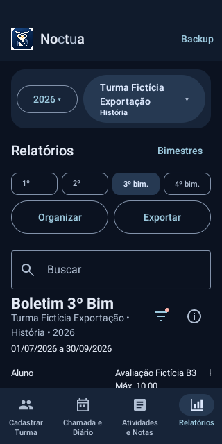
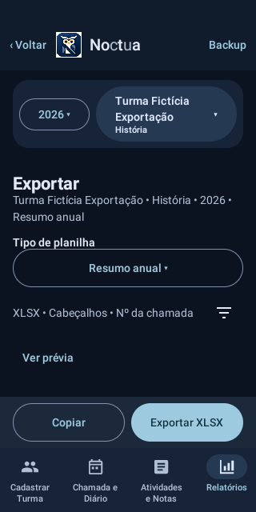
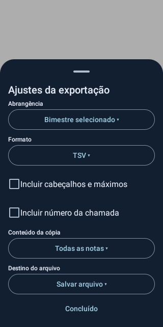
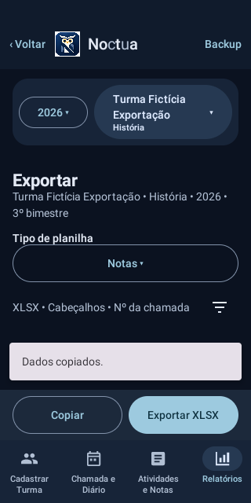

# Noctua 0.16.0 — Relatórios e exportação minimalistas

Base: Noctua 0.15.2 / código 27. Candidato: 0.16.0 / código 28.

## Fluxo do professor

**Relatórios → bimestre → Exportar → Exportar XLSX.** O período vem da seleção global; não existe um segundo seletor de bimestre na operação comum. Ao voltar, a seleção permanece. Configurações e prévia não são passos obrigatórios.

Relatórios mantém Organizar, Exportar, Buscar e o boletim. O ícone de filtro reúne Geral/Frequência/Notas, as ordenações existentes, ordem alfabética e Mostrar remanejados. Organizar continua tendo uma responsabilidade diferente: ocultação manual, ordem e linhas vazias da planilha. Filtros do boletim não mudam a chamada nem a disposição personalizada.

Exportar possui um seletor compacto para **Notas, Frequência, Consolidado, Chamada, Planos de aula e Resumo anual**. Cabeçalho identifica turma, disciplina, ano e período uma única vez. Ações diretas: Copiar e Exportar XLSX.

## Ajustes sob demanda

O ícone de ajustes abre uma folha inferior Material 3. Cada modelo oferece somente parâmetros aplicáveis:

- Notas/Frequência/Consolidado: abrangência bimestral herdada ou quatro bimestres; XLSX/CSV/TSV; cabeçalhos; número da chamada; destino salvar/compartilhar.
- Notas/Consolidado: conteúdo da cópia — dados completos, somente resultados vigentes ou todas as notas. O resumo identifica quando a cópia contém apenas notas. A exportação de arquivo continua completa conforme o modelo; essa escolha é explicitamente da cópia.
- Chamada/Planos: bimestre herdado ou intervalo personalizado. O resumo anual utiliza o ano da turma.
- Chamada/Resumo anual: cabeçalhos e número da chamada. Planos preserva o formato próprio, incluindo Data/Título/Descrição e sua formatação aprovada.

Concluído fica fixo no rodapé da folha e apenas a fecha; alterações simples não exigem salvamento. Preferências ficam no estado restaurável da interface, separadas por turma e modelo; sobrevivem à rotação e à ida e volta na navegação. Não são novas preferências Room nem integram o backup. A disposição personalizada existente continua persistente no banco e nos backups, sem alterações.

Ver prévia abre uma visualização rolável da mesma matriz usada no arquivo. Fechar retorna sem perder opções. Não existe bloco permanente Prévia — Somente notas.

## Implementação e preservação

`ExportPresentation` adapta parâmetros das projeções existentes. Não contém cálculos acadêmicos. `SpreadsheetKind` reúne os seis destinos; `SpreadsheetPreferences` é exclusivamente estado de UI. `ExportScreen` centraliza seleção, ajustes, cópia, prévia e entrega pelo seletor Android/compartilhamento. `AttendanceExportScreen` encaminha destinos antigos restaurados para o mesmo componente.

As projeções `ExportProjection`, `AttendanceExportProjection`, `AnnualExportProjection` e `LessonPlanExportProjection` preservam suas regras. XLSX e CSV continuam usando os mesmos escritores; TSV reutiliza literalmente a matriz tabulada antes utilizada na área de transferência. A prévia também usa `ExportTable.rows()`.

Não foram criadas opções decorativas de situação, máximos ou colunas que não existiam: situação segue o modelo existente; máximos acompanham os cabeçalhos de Notas; resultados originais/recomposição/vigentes continuam disponíveis. A exclusão automática de remanejados na origem permanece inalterada e é distinta da consulta histórica no boletim.

Sem alteração de Room v8, suas 14 tabelas, migrações, banco `diario.db`, backup formato 10 ou leitores antigos. Sem alteração de `br.com.diariodeclasse`, certificado, Secrets ou regras de notas/frequência/remanejamentos. Nenhuma instalação real de professor é utilizada nos testes.

## Design e acessibilidade

Impeccable 4.7.0 foi lido do diretório instalado no projeto `.agents/skills/impeccable/`. Foram aplicadas as referências `distill`, Android e `craft-floor`: divulgação progressiva, ações diretas, controles Material 3, alvos de pelo menos 48 dp, hierarquia existente e preservação da identidade noturna. Não há nova identidade visual. As duas ações ficam lado a lado nas larguras normais e se empilham em fontes maiores ou larguras menores, em vez de comprimir os textos. A folha abre expandida quando há muitas opções e mantém Concluído sempre acessível. Ajustes e prévia respeitam Voltar do Android.

## Validação

**Entrega aprovada:** execução 39864960677, código `4a52066`, 148 JVM e 243 Android sem falhas; atualização assinada sobre a release 0.15.2 e seis fases de preservação aprovadas. Evidências detalhadas abaixo e no JSON de resultados.

Cobertura acrescentada: equivalência das seis projeções padrão, combinações de cabeçalhos/números/abrangência, cópias completas/vigentes/históricas, zero/pendente/linhas vazias, TSV/CSV, parâmetros por modelo, bimestre herdado e rotação, ausência de prévia obrigatória, todos os modelos acessíveis, filtros agrupados e preservação do snapshot Room.

A instrumentação anterior foi adaptada somente onde os caminhos de acesso mudaram, mantendo as verificações de integridade, histórico, compartilhamento, cancelamento e conteúdo. A atualização assinada usa o APK real 0.15.2 e a chave permanente já configurada, sem criação ou troca de chave.

Limitação do ambiente local: não há `/dev/kvm`; capturas e testes de navegação rodam no emulador descartável do GitHub Actions. Validação física do professor continua recomendada após a entrega, especialmente com teclado e escala de fonte próprios.

### Primeira execução de instrumentação

A execução [39860766408](https://github.com/italocesarfr-sketch/CHATGPTCODEX/actions/runs/39860766408) passou por 148 testes JVM, validadores independentes e 35 cenários Android focados anteriores. Nos 21 cenários focados de relatórios/exportação, duas automações ainda chamavam `performScrollTo()` para as ações Copiar/Exportar, agora fixas fora da lista. Falharam antes de executar a ação por ausência de ancestral rolável. Foram atualizadas para exigir visibilidade e clicar diretamente; as verificações de cancelamento, área de transferência e igualdade do backup continuam presentes. Essa execução não aprovou uma release.

A revisão das capturas reais também levou a reduzir espaçamentos, manter ações lado a lado em 320 dp na fonte normal e fixar o fechamento da folha de ajustes. A troca entre turmas ganhou um cenário explícito; filtros vazios durante a busca global não são exibidos. A aprovação final depende da nova execução integral.

### Segunda execução de instrumentação

A execução [39862135653](https://github.com/italocesarfr-sketch/CHATGPTCODEX/actions/runs/39862135653) passou pelo teste visual inicial, pelos 35 cenários anteriores e por 21 dos 22 cenários de relatórios/exportação. A cópia consecutiva expôs uma sobreposição real: o snackbar ocupava a região das ações porque estas estavam no conteúdo do Scaffold. A segunda cópia podia ser interceptada e deixar o texto anterior na área de transferência. As ações foram movidas para `Scaffold.bottomBar`, mantendo o snackbar acima delas. O teste mantém a comparação exata de ambas as cópias e acrescenta uma asserção geométrica contra sobreposição, sem esperar artificialmente que a mensagem expire. Nenhum cálculo, dado ou escritor foi alterado por essa correção.

### Terceira execução de instrumentação

A execução [39863260890](https://github.com/italocesarfr-sketch/CHATGPTCODEX/actions/runs/39863260890) aprovou os 35 cenários anteriores e os 22 cenários focados, incluindo cópias consecutivas sem sobreposição. A regressão integral chegou ao fim com uma falha na nova medição de overflow de texto do layout compacto. A checagem foi alinhada à prova geométrica já existente para Organizar/Exportar: cobertura integral dos caracteres, ausência de reticências, linha única, limites reais dos glifos, texto dentro do botão e altura mínima de toque. Capturas e medidas por escala são arquivadas para revisão; o resultado final dependerá da nova instrumentação. Não foram alterados valores esperados de dados escolares nem removidas verificações de integridade.

## Evidências da execução final

Código e testes: `4a5206611928fad0ceea35c9c75da5f5496b0c15`. [Execução 39864960677](https://github.com/italocesarfr-sketch/CHATGPTCODEX/actions/runs/39864960677).

A validação principal foi aprovada: **148 JVM**, **243 Android**, sem falhas. A suíte Android contém 247 casos, dos quais quatro são sondas condicionais fora da execução geral. A sonda de frequência/reinício e a atualização legada foram executadas separadamente pelo script. O job de assinatura realiza a prova específica da release permanente.

Também passaram **2 testes visuais iniciais**, **35 cenários anteriores focados** e **22 cenários de relatórios/exportação**. Os leitores independentes conferiram **41 XLSX gerais + 2 XLSX de planos**, **41 CSV** e **123 TSV**, incluindo arquivos efetivamente produzidos pelo Android. Zero numérico, pendência vazia, pontuação máxima, acentos, quebras de linha, recomposição, frequência, remanejamentos e linhas vazias mantiveram a equivalência.

A medição confirmou o falso positivo da antiga asserção: em fonte 1,6×, “Exportar XLSX” ocupa 141,54 px de glifos em um nó Text de 142 px, dentro do botão de 288 px. O parágrafo reserva 264 px; por isso `didOverflowWidth` fica verdadeiro mesmo sem corte. As novas verificações exigem todos os caracteres, linha única, ausência de reticências e glifos/texto dentro dos limites visíveis. [Medidas nativas completas](images/relatorios-exportacao-0160/medidas-layout.txt).

### Capturas reais do emulador

Dados exclusivamente fictícios, produzidos nesta execução. As imagens foram copiadas sem redesenho ou edição.

| Relatórios | Exportar (modelo Resumo anual) |
| --- | --- |
|  |  |

| Ajustes sob demanda | Cópia sem sobreposição das ações |
| --- | --- |
|  |  |

[Componente Exportar em 320 dp e fonte 1,6×](images/relatorios-exportacao-0160/fonte-ampliada.png) · [Prévia opcional](images/relatorios-exportacao-0160/previa.png).

### Arquivos alterados

Lista de código, testes, compilação e documentação do incremento em relação à 0.15.2; capturas e o JSON de resultados complementam a lista.

```text
.github/workflows/android.yml
README.md
app/build.gradle.kts
app/src/androidTest/java/br/com/diariodeclasse/ExportLayoutUiInstrumentedTest.kt
app/src/androidTest/java/br/com/diariodeclasse/ExportLifecycleUiInstrumentedTest.kt
app/src/androidTest/java/br/com/diariodeclasse/FinalUxEntryInstrumentedTest.kt
app/src/androidTest/java/br/com/diariodeclasse/FinalUxLayoutInstrumentedTest.kt
app/src/androidTest/java/br/com/diariodeclasse/FunctionalFifteenUiInstrumentedTest.kt
app/src/androidTest/java/br/com/diariodeclasse/PostTwelveLayoutInstrumentedTest.kt
app/src/androidTest/java/br/com/diariodeclasse/PostTwelveUiInstrumentedTest.kt
app/src/androidTest/java/br/com/diariodeclasse/PromptTwoUiInstrumentedTest.kt
app/src/androidTest/java/br/com/diariodeclasse/ReportsUiInstrumentedTest.kt
app/src/main/java/br/com/diariodeclasse/export/ExportFiles.kt
app/src/main/java/br/com/diariodeclasse/export/ExportPresentation.kt
app/src/main/java/br/com/diariodeclasse/export/ExportProjection.kt
app/src/main/java/br/com/diariodeclasse/export/SpreadsheetShare.kt
app/src/main/java/br/com/diariodeclasse/reports/SchoolReports.kt
app/src/main/java/br/com/diariodeclasse/ui/AttendanceExportScreen.kt
app/src/main/java/br/com/diariodeclasse/ui/DiaryApp.kt
app/src/main/java/br/com/diariodeclasse/ui/ExportScreen.kt
app/src/main/java/br/com/diariodeclasse/ui/ReportsScreen.kt
app/src/test/java/br/com/diariodeclasse/ExportPresentationTest.kt
docs/ESPECIFICACAO.md
docs/RELATORIOS_EXPORTACAO_0160.md
docs/ROADMAP.md
docs/baseline/noctua-release-0.15.2.json
scripts/ci/validate-android.sh
```

## Release assinada e atualização aprovada

**[Baixar APK release 0.16.0 / 28](https://github.com/italocesarfr-sketch/CHATGPTCODEX/actions/runs/39864960677/artifacts/12463554056)** · **[GitHub Actions aprovado](https://github.com/italocesarfr-sketch/CHATGPTCODEX/actions/runs/39864960677)** · [Resultados verificáveis](RELATORIOS_EXPORTACAO_0160_RESULTADOS.json).

O ZIP contém `app-release.apk`, checksum, identidade e relatório de compatibilidade. O nome legado do artefato `noctua-etapa6-release` foi mantido para compatibilidade do workflow; o manifesto interno foi conferido: **Noctua 0.16.0, código 28, `br.com.diariodeclasse`**. Este é o APK release permanente, não o artefato debug.

O APK existe e foi novamente verificado localmente com `apksigner`: assinatura v2 válida e certificado SHA-256 `6dbbba2d930eb7f7fbeff1ee82512f656251bbec9f4b31b6c5614528d29f1aae`, idêntico à release 0.15.2. Nenhuma chave privada foi criada, substituída, exibida ou publicada; Secrets e configuração permanente não foram alterados.

SHA-256 do APK: `2f096dd50d6223e2ce15ea6d2ed227636a7141c712051087bed0554a5a2b29cf`.

A identidade compatível foi acompanhada da prova de dados: instalação da release 0.15.2 real, criação de registros fictícios, `adb install -r` da nova release, comparação integral, backup/restauração, reinício e preservação de histórico após exclusão da origem. As seis fases `before`, `after`, `backup`, `reopened`, `deleted-history` e `reopened-history` passaram, sem desinstalação e sem dados reais. [Artefato da prova](https://github.com/italocesarfr-sketch/CHATGPTCODEX/actions/runs/39864960677/artifacts/12463489394).

Room v8 e seu JSON exportado permanecem byte a byte idênticos à base. Backup formato 10 e leitura de formatos 1–9 preservados. Não houve migração nem limpeza de tabelas nesta atualização.

A compilação e a regressão estão concluídas. Permanece a conferência prática pelo proprietário no seu aparelho e no Microsoft Excel; o ambiente executou emulador API 30, testes em 320/360 dp e fontes ampliadas, com leitores independentes de arquivos. As escolhas de apresentação sobrevivem à rotação e à navegação na sessão; não substituem a disposição persistente de exportação existente.
